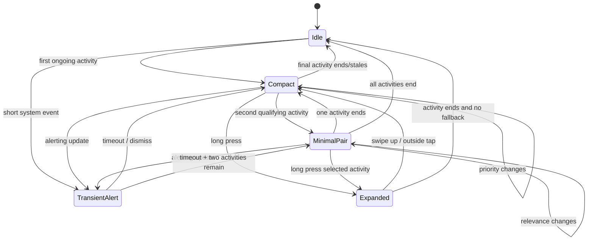
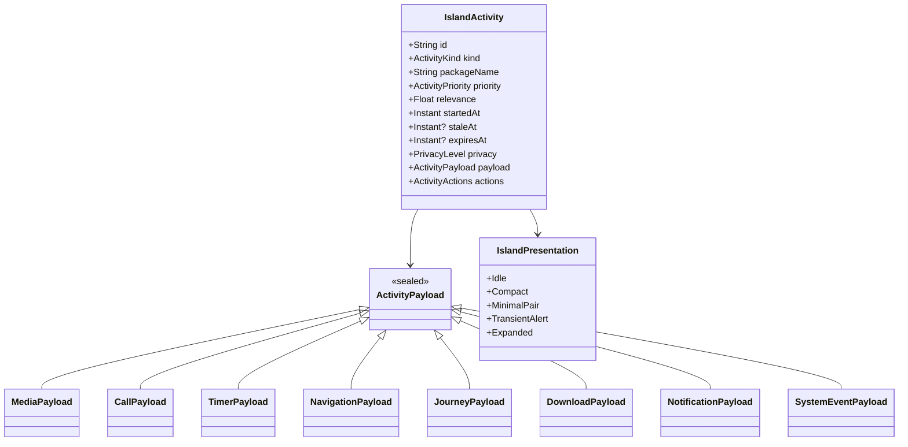
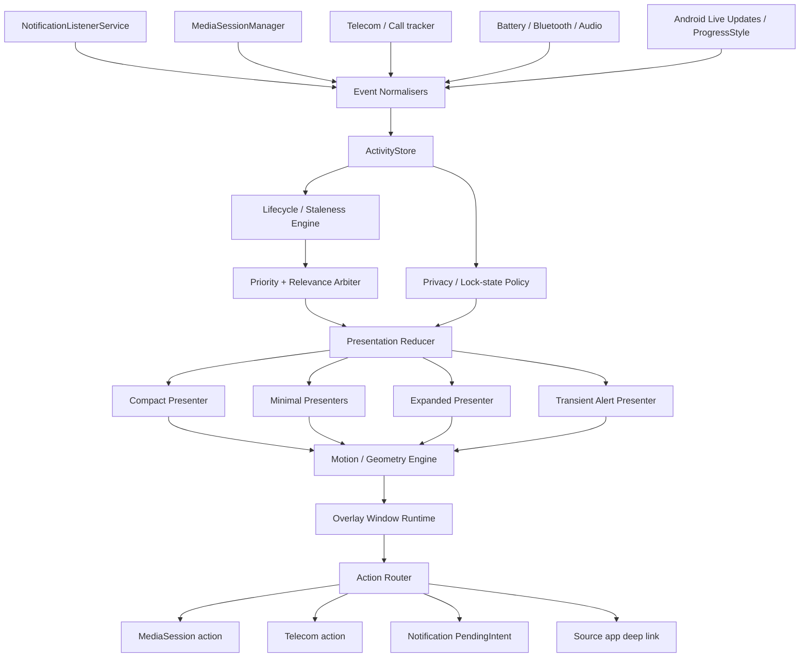
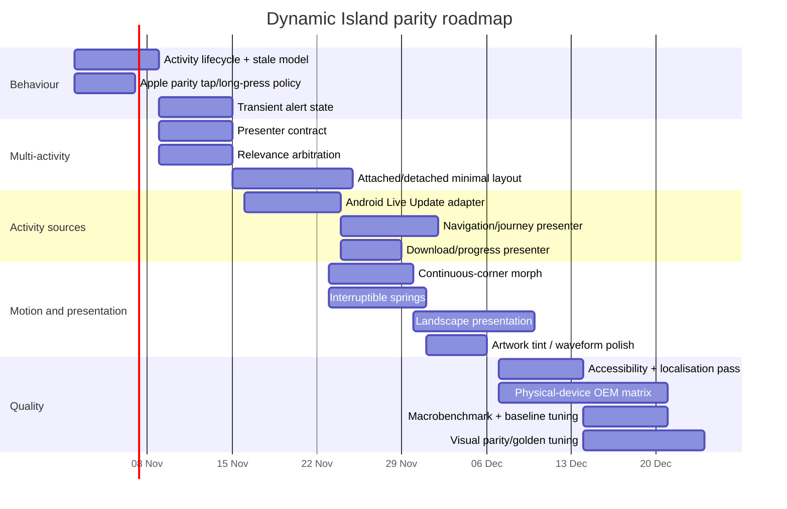

# Deep Research Report: Features to Add to `Darshan8610/Dynamic-Island` for Closer Apple Dynamic Island Behaviour

## Executive summary

The linked repository is **an Android project, not an iOS project**. Its current implementation is Kotlin/Jetpack Compose, supports Android API 28–36, uses an application overlay plus a foreground service, and already handles notifications, media sessions, calls, timers, battery, Bluetooth, microphone activity, grouping, configurable gestures, haptics settings, reduced-motion settings, rotation-aware placement and an optional secondary activity bubble. citeturn602860view0turn346324view0turn346324view3

That changes the recommendation substantially from the earlier iOS-oriented brief: UIKit, SwiftUI, ActivityKit, CallKit and Live Activities are useful as **behavioural references**, but the project itself should implement equivalents with Android APIs such as `NotificationListenerService`, `MediaSessionManager`, Telecom, `WindowManager`, `DisplayCutout`, promoted Live Updates/`Notification.ProgressStyle`, Compose, coroutines/Flow and the foreground-service APIs. Android overlay windows also remain below critical system windows such as the status bar, so a third-party Android implementation can approximate Apple's experience but cannot obtain Apple's system-level ownership of the sensor area or exactly reproduce all privacy, call and biometric integrations. citeturn185943search8turn185943search9turn296458search4

The largest remaining gap is now **behavioural rather than simply visual**. Apple treats Dynamic Island as a persistent activity surface with compact, minimal and expanded representations; a long press exposes the expanded representation; multiple concurrent activities are represented by two minimal presentations; relevance determines which activity wins; important updates can temporarily reveal an expanded presentation; activities have explicit stale/end lifecycle semantics; and modern Live Activities can expose a small number of direct actions. citeturn185943search0turn185943search1turn185943search4turn185943search5 Your repository currently expands media controls on a **tap**, keeps the compact capsule the same size for media and notifications, and implements the secondary activity as an optional independent bubble. Those are sensible Android choices, but they are not the closest Apple-parity behaviour. citeturn602860view0turn346324view0

The highest-value additions therefore are: an **Apple-parity interaction mode** in which tap opens the source and long-press expands; a transient alert/auto-expansion state; true compact/minimal/expanded activity presentations; score-based arbitration for multiple ongoing activities; lifecycle/staleness management; Android 16+ Live Update ingestion; landscape-side presentation; more faithful progress activities such as navigation, rideshare, downloads and delivery; contextual one-action interactivity; and a unified interruption/state machine so calls, media, timers, notifications and transient system events morph rather than behave like unrelated pop-ups. Apple's current HIG explicitly describes compact, minimal, expanded and Lock Screen presentations and advises that interactions remain simple and directly related to the ongoing activity. citeturn185943search1turn185943search7

A practical target would be a **four-stage implementation over roughly eight to ten development weeks**: first correct interaction semantics and activity lifecycle, then multi-activity arbitration and motion, then Android Live Updates/progress activities and landscape handling, and finally visual polish, physical-device tuning and performance validation. The repository already has unit, lint and build coverage, Macrobenchmark infrastructure and Baseline Profile tooling, but its own test report says it has not yet passed physical-device interaction, frame-timing, visual-golden or OEM tests. citeturn574486view2turn346324view0

## What the project already has — and what Apple does differently

The current project is considerably further along than a simple floating notification pill. Its documentation lists persistent priority presets, configurable tap/hold/swipe actions, haptic strength, appearance and motion presets, reduced-animation support, a secondary activity bubble, media/call dashboards, grouped notifications, timer cancellation, redaction, quiet hours, package exclusions, multi-SIM identities, diagnostics and benchmark infrastructure. citeturn346324view0 It supports API 28–36 and already consumes notifications, media sessions, coarse telephone state, Bluetooth/battery information and microphone recording configurations, while explicitly refusing to pretend that global camera/privacy state is available to an ordinary Android app. citeturn346324view3

That means several ideas commonly suggested for “Dynamic Island clones” — basic media controls, generic notifications, charging status, a second bubble, swipe dismissal, haptics or a dark pill — are **not additional features for this repository**. They are already present in some form. citeturn346324view0turn346324view3

The most consequential mismatch is interaction semantics. Apple documents Dynamic Island Live Activities as compact when a single activity is active; when multiple activities compete, the system selects two and renders each using its minimal representation, one attached and one detached. A long press opens the expanded representation, while tapping a Live Activity deep-links into the relevant application. citeturn185943search0turn185943search4 By contrast, this repository currently says “Tap the capsule to expand music controls in place”. citeturn602860view0

A second mismatch is lifecycle. Apple's ActivityKit gives every activity explicit start/update/end semantics, optional staleness and a relevance score. citeturn185943search0turn185943search5 A generic notification feed is not the same thing. To feel like Dynamic Island, your renderer needs to understand that a timer, navigation journey, media session and notification peek have different lifetimes even if they all originate from Android notifications.

A third mismatch is presentation choice. Apple distinguishes **compact**, **minimal**, **expanded** and Lock Screen representations rather than merely scaling one card. citeturn185943search1 Your repository's optional secondary bubble is useful, but Apple-style concurrency requires every activity presenter to expose a dedicated minimal representation and for the arbiter to decide which one is attached, which one is detached and which remain hidden.

Finally, Android itself now provides a useful native analogue. Android Live Updates are intended for ongoing, user-initiated, time-sensitive activities and promoted updates can appear prominently on the Lock Screen, notification stack and status surfaces. Android 16 introduced `Notification.ProgressStyle` for journeys such as navigation, rideshare and delivery, with milestones, segments and tracker icons. citeturn296458search0turn296458search1 Feeding those signals into your overlay would allow the island to understand real “live activity” semantics instead of relying primarily on notification text heuristics.

## Prioritised additions

The following priorities assume the goal is **behavioural fidelity to Apple's Dynamic Island while staying within public Android APIs**. The iOS dependencies in the final column are references to the Apple feature being emulated; they are not dependencies of this Android repository.

| Priority | Feature / behaviour | Why add it / user benefit | Complexity | Android dependencies | Apple reference |
|---|---|---|---|---|---|
| **Core** | **Apple-parity tap/long-press mode** | Tap should open the source activity; long-press should expand the island. This immediately makes interaction muscle-memory closer to iPhone. Offer the existing tap-to-expand behaviour as a user-selectable Android mode rather than removing it. | Low | Compose pointer input, `PendingIntent`/launch intent, haptics | Apple documents long-press expansion and tapping into the underlying app. citeturn185943search0turn185943search4 |
| **Core** | **Transient “alerting update” state** | Incoming call, navigation turn, timer completion, charging connection or important notification should briefly morph the island larger and then settle automatically. It produces the “island came alive” quality missing from permanently fixed pills. | Medium | Existing event bus, state machine, coroutine timeout, Compose animation | Important Live Activity updates may cause the expanded presentation to appear. citeturn185943search1turn185943search5 |
| **Core** | **Explicit compact / minimal / expanded presenter contract** | Each activity gets purpose-built information density instead of merely resizing the same content. Improves glanceability and makes concurrency possible. | Medium | Compose presenter interfaces | Apple requires compact, minimal and expanded presentations. citeturn185943search1 |
| **Core** | **True two-activity Dynamic Island layout** | Replace or augment the independent bubble with Apple-style attached + detached minimal presentations when two high-priority activities coexist. | High | Overlay geometry, existing secondary window, activity store, animation engine | Dynamic Island displays up to two Live Activities using minimal presentations. citeturn185943search4 |
| **Core** | **Relevance-score arbitration** | Calls should outrank navigation; imminent turns outrank passive music; a timer finishing should briefly outrank playback. Eliminates random-looking replacement of content. | Medium | Priority reducer / arbiter | ActivityKit uses relevance scores to determine which activity wins. citeturn185943search5 |
| **Core** | **Activity lifecycle and stale-state model** | Prevents old journeys, expired timers or disconnected media sessions lingering in the island. | Medium | Flow, monotonic timestamps, scheduled expiry | ActivityKit supports stale dates and explicit activity end state. citeturn185943search0 |
| **Core** | **Android 16+ Live Update / `ProgressStyle` ingestion** | Real navigation, rideshare and delivery journeys can become first-class island activities rather than generic notifications. | Medium–High | API 36, `Notification.ProgressStyle`, `NotificationListenerService`; fallback parser below API 36 | Android Live Updates are explicitly designed for ongoing, user-initiated, time-sensitive progress. citeturn296458search0turn296458search1 |
| **Core** | **Landscape island instead of hide-only behaviour** | Latest Apple behaviour keeps Live Activities available in landscape; Android users should get a lateral/minimal presentation instead of simply losing the island. | High | `WindowMetrics`, `DisplayCutout`, rotation listener | Apple's WWDC26 guidance says Live Activities appear in Dynamic Island in portrait and landscape on iOS 27. citeturn185943search7 |
| **Core** | **Navigation activity presenter** | Turn icon, distance, road name and progress are among the best fits for glanceable persistent UI. | Medium–High | `CATEGORY_NAVIGATION`, `ProgressStyle`, compatible notification extras; no scraping inaccessible app UI | Progress-centric notifications explicitly target navigation. citeturn296458search0turn296458search1 |
| **Nice-to-have** | **Journey presenter for rideshare / food delivery** | ETA, driver/order progress and milestones map almost exactly to Live Activity semantics. | Medium | `ProgressStyle`, app notification metadata | Both Apple's and Android's Live Activity systems cite delivery/journey use cases. citeturn185943search0turn296458search1 |
| **Nice-to-have** | **Download / file-transfer activity** | A compact progress ring plus expanded throughput/progress card provides useful persistent feedback. | Medium | Notification progress parsing, optional DownloadManager observation | This is an inference from progress-centric activity design rather than an Apple-specific public API requirement. citeturn296458search0 |
| **Nice-to-have** | **Contextual one-action controls** | Examples: pause timer, mute call, pause media, cancel navigation. Limits interaction clutter while preserving direct utility. | Medium | MediaSession/Telecom/notification actions | Apple's HIG recommends keeping Live Activity interactions simple and usually limiting them to essential functionality. citeturn185943search1turn185943search2 |
| **Nice-to-have** | **Dynamic artwork tint + compact waveform** | Gives Now Playing the colour/liveliness users associate with Dynamic Island while keeping a black surface. | Medium | Palette extraction or local bitmap sampling, Canvas | The repo's own reverse-engineered specification already defines this as a target, although it is not an Apple-published geometry/API contract. citeturn867308view0 |
| **Nice-to-have** | **Continuous-corner morphing** | Avoids the visual impression that one rounded rectangle disappears and another replaces it. | Medium | `androidx.graphics:graphics-shapes`, custom `Shape`/Canvas | AndroidX Graphics Shapes directly supports rounded shapes and morphing. citeturn703121search0turn703121search5 |
| **Nice-to-have** | **Interruptible motion** | If a call arrives halfway through a music expansion, the animation should retarget from the current geometry instead of snapping. | Medium–High | `Animatable`, custom spring engine | Apple recommends preserving and moving existing elements during layout changes rather than removing and recreating them. citeturn445606search2 |
| **Nice-to-have** | **Smart Lock Screen privacy mode** | Show generic “Playing”, “Active call” or “Timer” labels when locked, full content after unlock. The repo already partially redacts; this should become presenter-level policy. | Low–Medium | Keyguard state, existing privacy settings | Current repo already blocks/redacts sensitive actions/content when locked. citeturn346324view0turn346324view3 |
| **Optional** | **Full dialler-role call integration** | Answer/decline, mute, speaker, hold, Bluetooth routing and call waiting can approximate Apple's phone island much more closely. | High | `ROLE_DIALER`, `InCallService`, Telecom | The current project intentionally limits actions without control eligibility; full integration therefore requires stronger user-granted platform roles. citeturn346324view3 |
| **Optional** | **Transient AirPods/Bluetooth-style connect card** | Device name, icon and battery when headphones connect gives an Apple-like system-event feel. | Medium | Bluetooth permissions/API 31+, vendor-dependent battery data | The repository already observes Bluetooth but correctly notes vendor battery broadcasts are not guaranteed. citeturn346324view3 |
| **Optional** | **Local biometric success animation** | Can emulate the visual pattern after *your own app's* `BiometricPrompt`, but should never pretend to represent system-wide Face ID. | Medium | `BiometricPrompt` inside own app only | Cross-application Face ID-style ownership is not available to an ordinary Android overlay; this should remain an app-local effect. |
| **Do not fake** | **Global camera privacy indicator** | Showing a green camera dot when you cannot actually know camera use would create a false security signal. | — | Privileged global AppOps unavailable to ordinary apps | The project's own compatibility matrix explicitly marks global camera/combined privacy state unavailable. citeturn346324view3 |

A particularly important addition is Android Live Update support. As of the current Android platform, promoted Live Updates can appear prominently on the lock screen and status surfaces, and qualifying activities are intended to be ongoing, time-sensitive and user initiated. citeturn296458search0turn296458search10 This gives your project a far more reliable semantic signal than parsing arbitrary title text such as “Driver arriving in 4 mins”.

## Interaction, animation and visual specification

Apple does **not** publish the physical sensor island's exact animation constants or every pixel dimension as a supported developer contract. The numbers already present in your repository's “Reverse Engineering Specification” should therefore be treated as **your project's visual target**, not as official Apple specifications. The document itself now labels historical claims as non-current validation. citeturn867308view0

For consistency with that project target, I would retain a nominal compact geometry of approximately **125 × 37 dp**, a minimal detached surface of roughly **37 × 37 dp**, an **8 dp gap** between minimal presentations, and a compact radius equal to half the height. Your existing specification proposes an expanded reference around **370 × 160 dp with a 44 dp continuous radius**, but on Android the actual expanded width should be `min(targetWidth, windowWidth - safeInsets - 24dp)` rather than hard-coded. citeturn867308view0 Cutout position itself should continue to come from `DisplayCutout`/`WindowInsets`; Android explicitly advises against hard-coding cutout or status-bar geometry. citeturn296458search5turn296458search8

Recommended presentation states:

```text
IDLE
  125×37          no activity content

COMPACT
  variable width  one activity: icon/artwork + primary glanceable datum

MINIMAL_PAIR
  [primary pill]  8dp  [secondary circle]
  two concurrent ongoing activities

TRANSIENT_ALERT
  wider/taller compact surface for 1.8–3.0 s
  then returns to COMPACT/MINIMAL_PAIR

EXPANDED
  almost screen width
  richer information + at most a few essential controls
```

For motion, keep the repository's spring-oriented philosophy. Its reverse-engineered spec currently proposes approximately `response=0.48 s, damping≈0.80` for compact→expanded, `0.40/0.86` for collapse and `0.52/0.72` for activity detachment. citeturn867308view0 I would use those as initial tuning values, then validate by side-by-side high-frame-rate recordings rather than treating them as authoritative Apple constants.

The transition sequence matters more than matching one timing constant:

```text
Compact → Expanded
0–60 ms      press compression, scale ≈ 0.985
0–250 ms     width grows; leading/trailing compact items maintain identity
80–360 ms    bottom edge descends; expanded secondary content fades/slides in
~450 ms      spring settles

Expanded → Compact
0–120 ms     controls/content fade and translate toward compact anchors
40–320 ms    container returns to compact geometry
~400 ms      fully settled

Second activity arrives
0–100 ms     compact content resolves new priorities
70–400 ms    surface separates
~500 ms      two minimal presentations settle
```

These are engineering targets, not Apple-published values. Apple's HIG does establish the higher-level principle: preserve existing elements during layout changes, animate them into their new positions where possible, and avoid collisions during transitions. Live Activity custom animations are also constrained in Apple's environment to short durations, with two seconds as the documented maximum for Live Activity animation. citeturn445606search2

### Gestures, haptics and sound

In **Apple parity mode**, use:

| Gesture | Recommended result |
|---|---|
| Tap compact/minimal | Open the originating app/activity via its `PendingIntent` |
| Long press ~450–500 ms | Expand |
| Tap expanded action | Execute the one directly related action |
| Swipe upward on expanded header | Collapse |
| Tap outside expanded card | Collapse |
| Horizontal swipe | Keep as an optional Android-only power-user binding |
| Swipe away transient alert | Suppress that instance, not the underlying ongoing activity |

Apple's public behaviour makes long-press→expanded and tap→application the most important parity change. citeturn185943search0turn185943search4

Haptics should be semantic rather than attached to every animation. Use a light selection/click for successful expansion, a slightly stronger confirmation when a destructive or definitive action completes, and no repetitive haptics for passive ticking timers or progress. Android's `performHapticFeedback` APIs are designed for interaction feedback and do not require a special vibration permission for the standard feedback path. citeturn703121search24turn703121search29 On newer Android releases richer vibration composition is available, but it should be capability-gated. citeturn703121search35

Do **not** add a proprietary “Dynamic Island sound”. Apple uses Live Activity alerts selectively and advises alerting only for essential updates. citeturn185943search1 On Android, rely on the originating notification/call/timer sound when appropriate; the overlay itself should normally be silent.

### Event-to-state model



This closely mirrors the distinctions Apple makes between ongoing compact/minimal states, expanded interaction and activity lifecycle, while adapting them to Android's overlay model. citeturn185943search0turn185943search4

### Activity data model



The critical design choice is to store **activities**, not “whatever notification was most recently received”. Apple's model separates static attributes from changing activity content and uses relevance/staleness to control presentation. citeturn445606search0turn185943search0

## Architecture and implementation approach

Your existing project already has an event-driven core, notification/media/telecom trackers, a typed event bus, priority arbitration and a Compose overlay. citeturn346324view4 The next revision should make that model explicit around an `ActivityStore` and separate **event ingestion** from **presentation policy**.



I would structure the modules approximately as:

```text
core/activity/
    IslandActivity.kt
    ActivityPayload.kt
    ActivityStore.kt
    ActivityLifecycleEngine.kt

core/arbitration/
    RelevancePolicy.kt
    IslandPriorityResolver.kt

core/presentation/
    PresentationReducer.kt
    PresentationState.kt

core/motion/
    MotionEngine.kt
    GeometryModel.kt
    ShapeMorph.kt

sources/
    notifications/
    media/
    calls/
    liveupdates/
    navigation/
    system/

ui/presenters/
    MediaPresenter.kt
    CallPresenter.kt
    TimerPresenter.kt
    NavigationPresenter.kt
    JourneyPresenter.kt
    GenericNotificationPresenter.kt

overlay/
    OverlayRuntime.kt
    OverlayWindowPolicy.kt

privacy/
    LockStatePolicy.kt
    RedactionPolicy.kt

metrics/
    IslandTrace.kt
    FrameMetrics.kt
```

### Priority arbitration example

Because the repository is Android, Kotlin/Compose is the useful implementation language here; Swift/SwiftUI would not compile in this project.

```kotlin
data class IslandCandidate(
    val activity: IslandActivity,
    val basePriority: Int,
    val relevance: Float,
    val interruptBoost: Int = 0
)

fun chooseVisible(
    activities: List<IslandCandidate>
): List<IslandActivity> =
    activities
        .filterNot { it.activity.isStale }
        .sortedWith(
            compareByDescending<IslandCandidate> {
                it.basePriority + it.interruptBoost
            }.thenByDescending {
                it.relevance
            }.thenByDescending {
                it.activity.startedAt
            }
        )
        .take(2)
        .map { it.activity }
```

Apple's ActivityKit similarly uses relevance to determine which of multiple activities receives Dynamic Island prominence. citeturn185943search5

A useful policy would be something like:

```text
incoming/ringing call              1000
navigation: manoeuvre < 20 sec      900
timer: <= 10 sec / completed        850
active call                          800
navigation ongoing                   700
active recording / microphone        650
music/podcast playing                500
rideshare/delivery                   450
download                             300
notification peek                    200
charging/accessory transient         150
```

Those numbers are project policy, not Apple values.

### Presentation reducer example

```kotlin
fun reducePresentation(
    visible: List<IslandActivity>,
    expandedId: String?,
    transient: TransientEvent?
): IslandPresentation =
    when {
        transient != null ->
            IslandPresentation.TransientAlert(transient)

        expandedId != null ->
            visible.firstOrNull { it.id == expandedId }
                ?.let(IslandPresentation::Expanded)
                ?: IslandPresentation.Idle

        visible.size >= 2 ->
            IslandPresentation.MinimalPair(
                primary = visible[0],
                secondary = visible[1]
            )

        visible.size == 1 ->
            IslandPresentation.Compact(visible[0])

        else ->
            IslandPresentation.Idle
    }
```

### Interruptible expansion

```kotlin
@Composable
fun IslandSurface(
    state: IslandPresentation
) {
    val target = geometryFor(state)

    val width = remember { Animatable(target.width) }
    val height = remember { Animatable(target.height) }
    val radius = remember { Animatable(target.radius) }

    LaunchedEffect(target) {
        coroutineScope {
            launch {
                width.animateTo(
                    target.width,
                    spring(dampingRatio = 0.80f, stiffness = 170f)
                )
            }
            launch {
                height.animateTo(
                    target.height,
                    spring(dampingRatio = 0.80f, stiffness = 170f)
                )
            }
            launch {
                radius.animateTo(
                    target.radius,
                    spring(dampingRatio = 0.84f, stiffness = 200f)
                )
            }
        }
    }

    IslandCanvas(
        width = width.value,
        height = height.value,
        radius = radius.value,
        state = state
    )
}
```

The exact spring constants should be tuned from your repository's motion reference rather than treated as Apple guarantees. citeturn867308view0

For the shape itself, prefer either your custom continuous curve implementation or AndroidX `graphics-shapes`. The latter exists specifically for rounded shape generation and morphing and can produce intermediate shapes from a `Morph` progress value. citeturn703121search0turn703121search5

### Android Live Update ingestion

On API 36+, build a dedicated adapter that detects `Notification.ProgressStyle` and converts its progress, segments, points, ETA/chronometer and action into a `JourneyPayload`. Android's `ProgressStyle` supports progress segments, milestone points, start/end icons and a tracker icon, and is intended for navigation, rideshare and delivery-like journeys. citeturn296458search1turn296458search3

```kotlin
fun notificationToActivity(
    sbn: StatusBarNotification
): IslandActivity? {
    val n = sbn.notification

    return when {
        Build.VERSION.SDK_INT >= 36 &&
            n.notificationStyle == Notification.ProgressStyle::class.java -> {
            parseProgressActivity(sbn)
        }

        n.category == Notification.CATEGORY_TRANSPORT ->
            parseMediaActivity(sbn)

        n.category == Notification.CATEGORY_CALL ->
            parseCallActivity(sbn)

        else ->
            parseGenericNotification(sbn)
    }
}
```

The exact reflective/style-detection implementation should be API-gated and tested against actual Android 16/17 devices because OEM promotion rules can differ. Android's own Live Update documentation explicitly notes that manufacturers can impose additional eligibility criteria. citeturn296458search0

### Apple-side reference

If you later build an actual iOS companion rather than the Android clone, the architecture maps naturally to `ActivityAttributes`, `ContentState`, `ActivityConfiguration` and `DynamicIsland`:

```swift
DynamicIsland {
    DynamicIslandExpandedRegion(.leading) {
        LeadingView(context: context)
    }
    DynamicIslandExpandedRegion(.trailing) {
        TrailingView(context: context)
    }
    DynamicIslandExpandedRegion(.bottom) {
        ExpandedControls(context: context)
    }
} compactLeading: {
    CompactLeading(context: context)
} compactTrailing: {
    CompactTrailing(context: context)
} minimal: {
    MinimalView(context: context)
}
```

That is the public Apple model: SwiftUI provides the Live Activity views, WidgetKit renders them and ActivityKit manages the lifecycle. citeturn445606search1turn445606search3

## Accessibility, privacy, localisation and edge cases

Accessibility should be treated as a first-class presenter output rather than bolted onto the final overlay. Compose exposes semantics used by accessibility services; changing alert-like content can use a polite live region, and expanded panes can expose a `paneTitle`. citeturn703121search2turn703121search20 Each activity should therefore define something like `compactAccessibleLabel`, `expandedPaneTitle`, `stateDescription` and accessibility actions independently of the visual string.

Do not announce every progress tick. A timer that updates once per second or a media waveform that updates many times per second should not repeatedly trigger TalkBack. Use `LiveRegionMode.Polite` only for meaningful phase changes — “driver arriving”, “timer complete”, “call ended”, “route changed” — and expose timers as a stable state description. Compose specifically recommends polite live regions for brief important changes rather than turning continuously updating content into an interruption stream. citeturn703121search2

For large font/display scaling, compact text should truncate before geometry becomes unstable, while expanded cards should grow vertically to a bounded maximum. The repository already has adaptive large-font card height; retain that behaviour. citeturn346324view0 Never shrink critical action touch targets merely to preserve a pixel-perfect iPhone silhouette.

Localisation must support RTL at the presentation level. The project's existing secondary-placement logic already handles RTL in some places. citeturn346324view0 Progress bars, leading/trailing semantics and navigation direction should also mirror correctly; Android's `Notification.ProgressStyle` itself mirrors progress layouts for RTL. citeturn296458search3 Use Android resources/plurals rather than constructing strings such as `"${minutes} min"` manually.

Privacy policy should remain stricter than the visual goal. The project correctly clears retained notification data if listener access disconnects, redacts locked-state content and does not request Internet access. citeturn346324view0turn346324view3 Preserve those properties. The island may visually resemble a system component, which makes truthful permission and privacy behaviour particularly important.

Do not introduce AccessibilityService merely to gain more system visibility unless the application's genuine accessibility functionality requires it. The current release deliberately does not register one. citeturn346324view3 Likewise, don't fake a global green camera privacy dot: the compatibility matrix correctly notes that ordinary applications cannot reliably observe global camera/combined privacy state. citeturn346324view3

Battery/performance should be event-driven. Apple's HIG advises updating Live Activity content only when new information exists. citeturn185943search1 On Android, the same principle means no polling loop for media position, battery or notifications when static; render local elapsed time from a start timestamp where possible and only recompose the portions that visibly change. Avoid running waveform analysis unless media is actually playing and the waveform is visible.

Android overlay constraints must remain explicit. `TYPE_APPLICATION_OVERLAY` windows sit above ordinary activity windows but below critical system windows, and the system can change their size, position or visibility. citeturn296458search4 Android 15 also tightened foreground-service behaviour for apps using `SYSTEM_ALERT_WINDOW`: holding the permission alone no longer gives the same background-start exemption; a visible overlay is part of the relevant exemption conditions. citeturn185943search10 Your service lifecycle should therefore be tested for boot, process death, permission revocation, screen off/on and OEM background restrictions.

Landscape/foldable behaviour deserves dedicated work. Android documentation recommends deriving cutout and safe-region behaviour from `WindowInsets`/`DisplayCutout` rather than hard-coded status-bar values. citeturn296458search5turn296458search8 Your own compatibility matrix says fold-state behaviour still needs instrumentation and names Realme/ColorOS, Pixel, Samsung and Xiaomi as physical validation targets. citeturn346324view3

Edge cases that should explicitly exist in the reducer include simultaneous incoming call + navigation turn; two SIM calls; timer completion during a call; media app disappearing while paused; source notification removed while its transient alert is visible; activity source process dying; lock/unlock while expanded; rotation halfway through a spring; overlay permission revoked while expanded; notification listener disconnected; source action `PendingIntent` cancelled; display/font scale changed; RTL changed; split/fold state changed; and animation scale set to zero.

## Testing, metrics, source priorities and delivery roadmap

The repository already passes substantial unit/build validation — its current report records 120 core and 117 engine unit tests with no failures — but explicitly states that physical-device interaction, frame timing, visual comparison and OEM tests have not yet been completed. citeturn574486view2 That is the most important quality gap to close before spending large amounts of time on more shader effects.

A practical release checklist should include:

- **State correctness:** every event sequence produces the correct primary/secondary activity, stale activities disappear, temporary events restore the previous state, and an interrupted animation always converges on the latest state.
- **Gesture parity:** tap opens source in Apple mode; long press expands; outside tap and upward swipe collapse; gestures never block the underlying screen outside the island's active bounds.
- **Concurrency:** call+music, navigation+music, timer+music, two notifications, two SIM calls, and three-or-more activities obey deterministic arbitration.
- **Geometry:** centred punch-hole, corner punch-hole, notch, no cutout, portrait, both landscape rotations, tablet/foldable and display-size changes.
- **Accessibility:** TalkBack exploration order, actions, polite live-region announcements, large text, high contrast, reduced motion and animation scale 0.
- **Privacy:** locked-screen redaction, listener revocation, overlay revocation, cancelled `PendingIntent`, secure-screen behaviour and no global camera-state claim.
- **Lifecycle:** process restart, boot, foreground-service restrictions, screen off/on, app update and OEM background kill.
- **Performance:** Macrobenchmark expansion/collapse, multi-activity detach/merge, notification arrival and media updates on real hardware.

Android recommends Macrobenchmark for Compose UI benchmarking, and Baseline Profiles are specifically recommended for improving Compose performance. citeturn703121search4turn703121search8 Since your repository already contains benchmark/profile infrastructure, the priority is to run it on representative physical phones rather than create another benchmarking layer. citeturn346324view0

Suggested **engineering SLOs** — these are project targets, not platform guarantees — are: less than 100 ms from an already-received Android event to island state mutation; no visible one-frame geometry snap during transitions; fewer than 1% janky frames in repeated expansion/collapse on the reference device; no continuous CPU work in idle state; zero recurring wakeups solely for static island content; no stale activity remaining more than one lifecycle interval after authoritative removal; and 100% deterministic arbiter results from identical input sequences.

For visual testing, maintain screenshot goldens for every presenter in compact/minimal/expanded modes, dark/light underlying backgrounds, LTR/RTL, font-scale 1.0/1.3/2.0, and reduced motion. The repository already includes a golden-comparison tool but has not yet produced physical-device-reviewed goldens. citeturn346324view0turn574486view2

### Technology and source priorities

**First priority: Apple's current Human Interface Guidelines and ActivityKit documentation.** The HIG is more important than copying screenshots because it explains the interaction model — compact/minimal/expanded modes, restrained interactions, alerting updates and animation principles. citeturn185943search1turn445606search2

**Second priority: WWDC26 “Live Activities essentials”.** This is particularly relevant because it reflects Apple's latest 2026 behaviour, including landscape Dynamic Island presentations and current recommendations for App Intents and activity modelling. citeturn185943search7

**Third priority: WWDC23 “Meet ActivityKit” and “Design dynamic Live Activities”.** These sessions clearly explain two-activity minimal presentation, long-press expansion and how information density changes across states. citeturn185943search4turn445606search7

**Fourth priority: Android Live Updates and `ProgressStyle`.** This is the best new Android-native signal source for your project and should become a dedicated activity adapter on API 36+. citeturn296458search0turn296458search1turn296458search3

**Recommended library:** `androidx.graphics:graphics-shapes`. It is an official Jetpack open-source library for rounded polygon construction and shape morphing. It is a better first choice than bringing in an animation framework solely for the island outline. citeturn703121search0turn703121search6

I would **not** add Lottie for the core island morph. Lottie is useful for pre-authored illustration animation, but the defining island movement depends on live geometry, interruption and event-driven retargeting, which are better handled by Compose/Canvas or a dedicated spring/morph engine.

For benchmarking, stay with official AndroidX Macrobenchmark and Baseline Profiles rather than introducing a third-party performance framework. citeturn703121search4turn703121search8

For open-source behavioural references, Jordi Bruin's `Dynamic-Islands` contains recreated Dynamic Island designs and can provide design inspiration, but it should remain secondary to Apple's current documentation. citeturn433886search11 Other Android clones can be useful for comparing problem-solving approaches, but your project is already architecturally beyond many simple notification-overlay repositories.

Apple's patent **US12524969B2 / earlier publication US20240112419A1, “Method and Device for Dynamic Determination of Presentation and Transitional Regions”**, is relevant reading because it concerns dynamically determining presentation/transitional regions and lists Apple as assignee. citeturn185943search11 Treat patent material as a design/research input, not as a freedom-to-operate opinion; copying a commercial interface can involve patent, copyright, trademark and trade-dress considerations depending on jurisdiction and distribution. A qualified IP lawyer would be required for a product-specific legal conclusion.

### Implementation trade-off summary

| Approach | Fidelity | Engineering cost | Platform risk | Recommendation |
|---|---:|---:|---:|---|
| Keep current fixed compact + tap expansion | Medium-low | Low | Low | Retain as “Android mode”, not default Apple-parity mode. citeturn602860view0 |
| Apple-style tap-launch + long-press-expand | High | Low | Low | **Implement first.** citeturn185943search4 |
| Independent secondary bubble | Medium | Already built | Low | Keep as optional setting. citeturn346324view0 |
| Attached + detached minimal activity pair | High | High | Medium | **Implement for parity.** Apple uses this presentation for concurrent activities. citeturn185943search0 |
| Generic notification parsing only | Medium | Low | Medium | Keep as fallback. |
| API 36+ Live Update / ProgressStyle parsing | High for journeys | Medium | Low | **Strongly recommended.** citeturn296458search0turn296458search3 |
| AccessibilityService-based system scraping | Potentially broader | High | High/privacy-sensitive | Avoid unless providing legitimate accessibility functionality. Current design intentionally avoids it. citeturn346324view3 |
| Full default-dialler integration | Very high call fidelity | High | Medium/high user commitment | Optional advanced feature. |
| Fake global camera/biometric indicators | Superficially high | Low | **High trust risk** | Do not implement. citeturn346324view3 |

### Suggested delivery timeline



The order is deliberate. **Do not start with metaball shaders or microscopic geometry tuning.** First make the island choose the right activity, use the right presentation, expand for the right reason and dismiss at the right time. Apple's Dynamic Island feels coherent primarily because its underlying activity and interruption model is coherent; the surface animation reinforces that model rather than replacing it. Apple's own Live Activity guidance similarly emphasises modelling state efficiently, choosing essential compact/minimal information, handling lifecycle correctly and adapting each presentation to its context. citeturn445606search0turn185943search1

The most important concrete changes to this repository, in order, are therefore **Apple-parity gestures → transient alert expansion → explicit lifecycle/staleness → compact/minimal/expanded presenter interfaces → relevance-based multi-activity arbitration → attached/detached two-activity rendering → Android Live Update ingestion → navigation/journey support → landscape mode → motion and visual refinement → physical-device validation**. That sequence would move the project from “a polished Android island overlay” toward something that behaves much more like the system model Apple actually uses, while remaining honest about the limits of a third-party Android application. citeturn185943search0turn185943search4turn296458search0turn346324view3